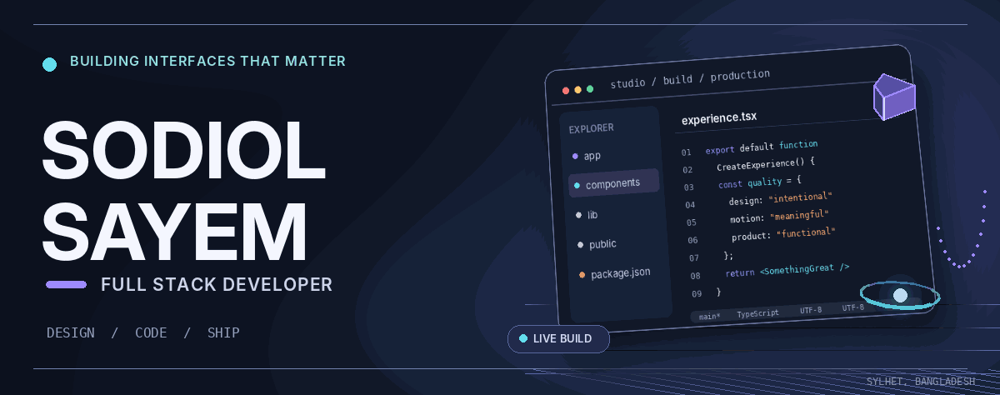
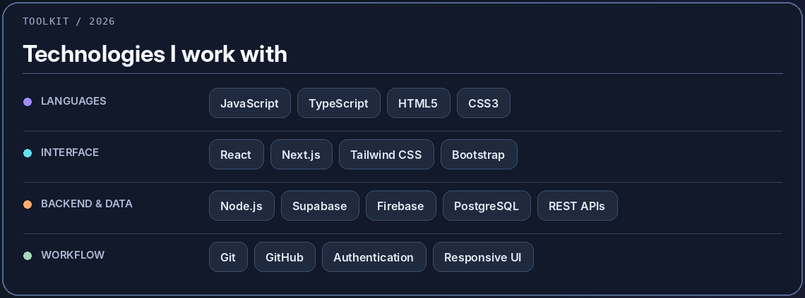
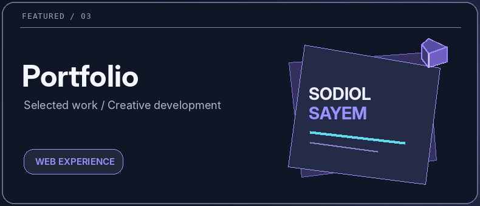
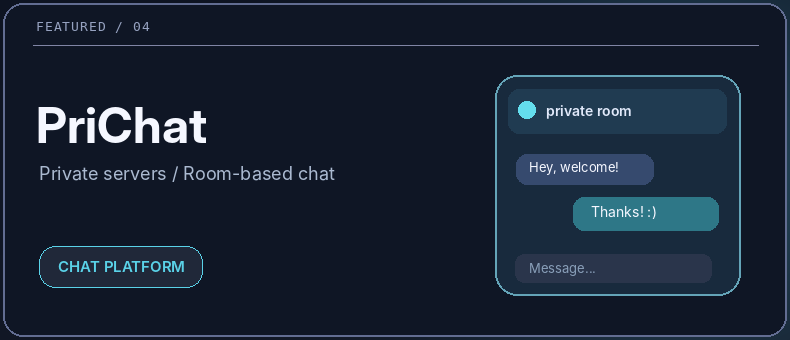

<!--
  SODIOL SAYEM — GitHub profile README
  Put this file in the root of your public Sodiols/Sodiols repository.
  Keep the assets/ directory alongside it. Animations are local GIFs,
  so the profile does not depend on JavaScript or animation services.
-->

  

  
  
  

  <strong>Self-taught web developer & designer</strong> based in Sylhet, Bangladesh 🇧🇩
   
  Building thoughtful interfaces and functional products, from idea to production.

 

### 01 / THE BUILDER

I’m **Sodiol Sayem**, a web developer and designer who enjoys the space where **visual design, interaction, and engineering** meet. I work across modern frontends, application logic, authentication, and data-backed experiences, with an emphasis on making every interaction feel intentional.

My approach is simple: **design with purpose, build with care, and keep improving what ships.**

  

### 02 / THE TOOLKIT

  

**Frontend:** React · Next.js · JavaScript · TypeScript · HTML · CSS · Tailwind CSS · Bootstrap  
**Backend & data:** Node.js · Supabase · PostgreSQL · Firebase · REST APIs · Authentication  
**Tools & workflow:** Git · GitHub · Responsive design · UI engineering

 

### 03 / SELECTED WORK

These are real projects I’ve worked on, each with a different product challenge.

**TARA** is a fashion e-commerce platform with a product-focused storefront, shopping flows, authentication, order management and backend functionality.  
**[Visit TARA](https://tarabd.co)**

 

**Husnalogy** is an invitation and gifting platform built around customization, meaningful design and an intuitive personalization experience.  
**[Visit Husnalogy](https://husnalogy.com)**

 

**Personal Portfolio** is my own space to experiment with creative development, interface details, motion and selected work.  
**[View Portfolio](https://sodiol-sayem.vercel.app)**

 

**PriChat** is a private chatting application where people can create servers and join a server using its ID and password.  
**[Open PriChat](https://prichat-ebf4.vercel.app)**

 

### 04 / GITHUB ACTIVITY

  
<strong>Expand my GitHub stats and most-used languages</strong>

   
  

    
    
  

 

### 05 / FIND ME ONLINE

  <a href="https://github.com/Sodiols">GitHub</a> &nbsp;·&nbsp;
  <a href="https://sodiol-sayem.vercel.app">Portfolio</a> &nbsp;·&nbsp;
  <a href="https://www.instagram.com/sodiol_sayem/">Instagram</a> &nbsp;·&nbsp;
  <a href="https://www.facebook.com/profile.php?id=100090420093597">Facebook</a> &nbsp;·&nbsp;
  <a href="mailto:itssayem2023@gmail.com">Email</a>

  DESIGN WITH PURPOSE &nbsp; • &nbsp; BUILD WITH CARE &nbsp; • &nbsp; KEEP SHIPPING

