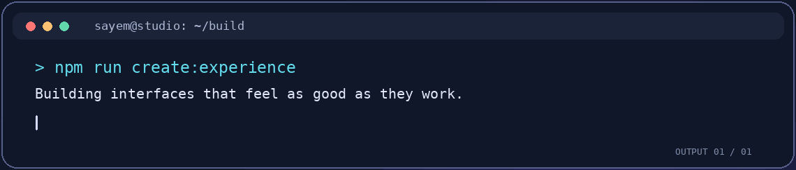
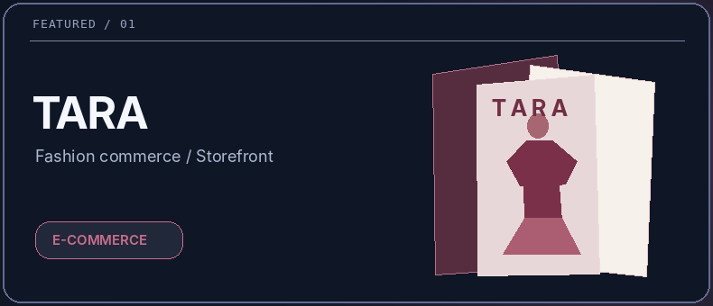
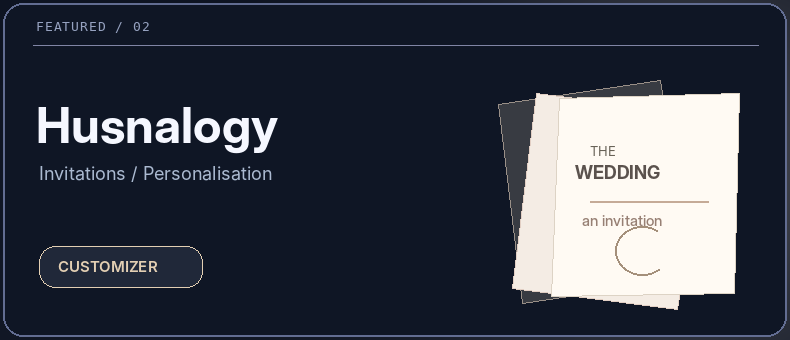

<a href="https://sodiol-sayem.vercel.app">
  <picture>
    <source media="(prefers-reduced-motion: reduce)" srcset="./assets/profile-cover.jpg">
    
  </picture>
</a>

# Hi, I’m Sodiol.

I’m a self-taught web developer and designer from Sylhet, Bangladesh. I work as a Senior Developer at **Meka Agency**, where I built **TARA** and **Husnalogy** as the sole developer.

  
  
  

## A little about me

I like working on both sides of a screen. On TARA, that meant figuring out how someone finds a dress in their size, then making sure the shop’s stock count is right when they buy it. My personal portfolio is where I play with the other details I enjoy, like typography and motion.

  
Play my terminal animation

  

## Selected work

### [TARA](https://tarabd.co)

A clothing store for a Sylhet brand. I built the catalogue, checkout and back office. One small detail I care about is that size and colour filters stay in the URL. If you find something you like, you can send a friend the same selection.

### [Husnalogy](https://husnalogy.com)

A shop for personalized invitations, wedding stationery and gifts. I built the editor where customers design their pieces. At checkout, the order saves a copy of their design so the team can still print exactly what they ordered if the template changes later.

### [My portfolio](https://sodiol-sayem.vercel.app)

My own corner of the web. I use it to try out interaction ideas and write about decisions that are hard to see from a finished storefront.

### [PriChat](https://prichat-ebf4.vercel.app)

A private chat app I built around a simple flow. Start a server and share its ID and password with the people you want to chat with.

## My toolkit

- **Interfaces** — HTML, CSS, JavaScript, TypeScript, React, Next.js, Tailwind CSS and Bootstrap.
- **Data and accounts** — Node.js, Supabase, PostgreSQL, Firebase, REST APIs and authentication.
- **Everyday work** — Git and GitHub for version control, responsive design and UI engineering. For Husnalogy’s canvas editor, I used Konva.

## GitHub activity

  
View my GitHub stats and most-used languages

  

    
    
  

[Explore my public repositories](https://github.com/Sodiols?tab=repositories)

## Find me online

If you’d like to talk about a project, email me at [itssayem2023@gmail.com](mailto:itssayem2023@gmail.com).

[Portfolio](https://sodiol-sayem.vercel.app) · [GitHub](https://github.com/Sodiols) · [Instagram](https://www.instagram.com/sodiol_sayem/) · [Facebook](https://www.facebook.com/profile.php?id=100090420093597)
