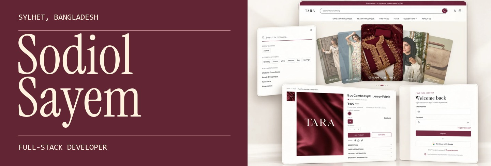

I’m **Sodiol Sayem**, a self-taught developer and designer in Sylhet, Bangladesh. As a Senior Developer at **Meka Agency**, I built TARA and Husnalogy from storefront to back office.

[View my portfolio](https://sodiol-sayem.vercel.app) · [Browse my repositories](https://github.com/Sodiols?tab=repositories) · [Email me](mailto:itssayem2023@gmail.com)

## Selected work

### [TARA](https://tarabd.co)

A fashion store for a Sylhet clothing brand. Shoppers can share a collection filtered to their size and colour. I built the catalogue, cash-on-delivery checkout and inventory tools, so placing an order also updates the stock available to the next shopper.

### [Husnalogy](https://husnalogy.com)

Customers personalize invitations and wedding stationery in a canvas editor. I built the editor and the order workflow that saves the exact design at checkout, so the production team can fulfil an order even after the original template changes.

### [PriChat](https://prichat-ebf4.vercel.app)

A private chat app where people can create a server or join a friend’s using its ID and password.

## Toolkit

I use **React, Next.js and TypeScript** for interfaces, **Tailwind CSS** for styling, and **Node.js, Supabase and PostgreSQL** for application logic and data. Husnalogy’s design editor uses **Konva**.

## Get in touch

For project enquiries, reach me at **[itssayem2023@gmail.com](mailto:itssayem2023@gmail.com)**. You can also find me on [Instagram](https://www.instagram.com/sodiol_sayem/) and [Facebook](https://www.facebook.com/profile.php?id=100090420093597).
